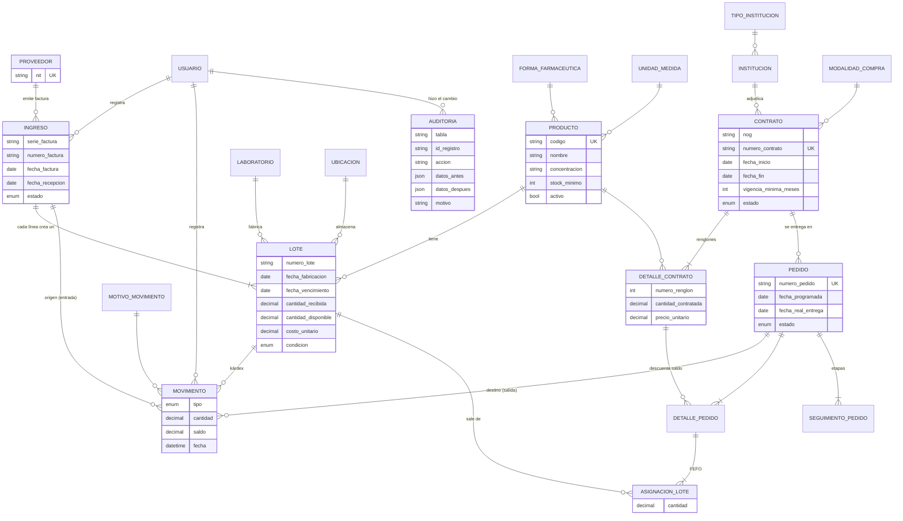
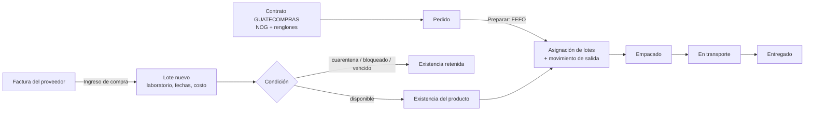
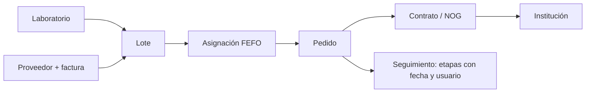

# ASIAFARMA — Modelo de datos y flujos

Referencia para actualizar los diagramas del proyecto (entidad-relación, flujo de inventario y trazabilidad). Los diagramas están en Mermaid: GitHub y VS Code (extensión "Markdown Preview Mermaid Support") los dibujan directamente.

## Diagrama entidad-relación

## Reglas principales

| Regla | Dónde se aplica |
|---|---|
| Un producto existe una sola vez (nombre + concentración + forma). Su existencia es la suma de sus lotes. | `productoController` |
| Un lote solo nace de un ingreso de compra (factura de un proveedor). Nunca se suma cantidad a un lote existente. | `ingresoController` |
| Vencimiento posterior a fabricación; fabricación no futura; vida útil mínima al ingresar (parámetro). | `services/inventario.js` y validación del modelo `Lote` |
| Las cantidades no se editan: toda entrada o salida es un movimiento con motivo de catálogo y saldo. | `services/inventario.js` |
| Las salidas por venta las decide el sistema por FEFO (vence primero, sale primero), respetando la vida útil mínima del contrato. | `proponerFEFO` |
| Un pedido no puede exceder el saldo del renglón del contrato. | `pedidoController.createPedido` |
| Nada se borra: se anula y se puede restaurar. Todo cambio queda en la auditoría con usuario, fecha, motivo, antes y después. | `utils/auditoria.js` |
| Cambiar fechas de un lote: solo administrador y con motivo obligatorio. | `loteController.updateLote` |
| Lotes vencidos y contratos con plazo terminado cambian de estado solos (cada hora). | `services/vencimientos.js` |

## Flujo de inventario

## Trazabilidad

Búsqueda: laboratorio → producto → lote o rango de fechas de compra → instituciones que lo recibieron (pantalla Trazabilidad e informe "Distribución de lotes").

## Estados

- **Lote (condición):** disponible · cuarentena · bloqueado · agotado · vencido · anulado
- **Pedido:** pendiente → en_preparacion → empacado → en_transporte → entregado (o anulado). El retraso se calcula.
- **Contrato:** vigente · completado · vencido · cancelado · anulado
- **Ingreso:** registrado · anulado
